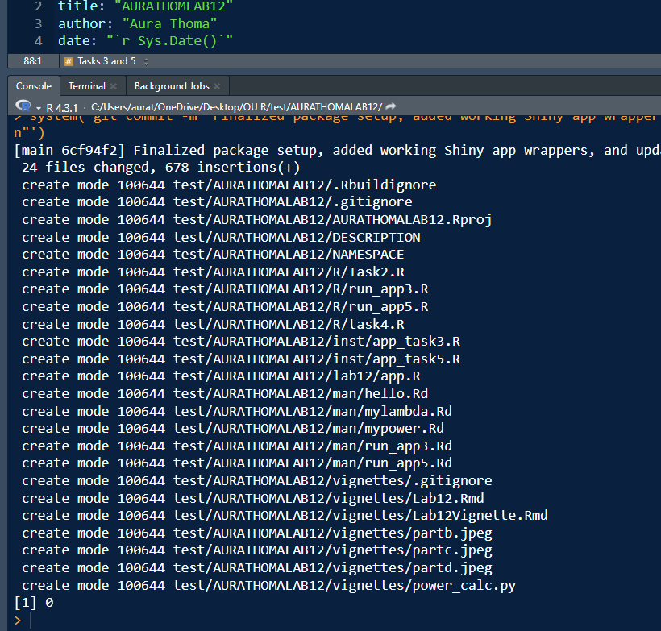

```{r, include = FALSE}
knitr::opts_chunk$set(
  collapse = TRUE,
  comment = "#>"
)
```

```{r setup}
# load package
library(AURATHOMALAB12)
```

# Task 2 {-}


```{r}
# Define the sample vector 
y <- c(4.4562, 5.4889, 4.4074, 5.0774, 4.9697, 4.6756, 4.8956, 5.9755, 4.6879, 5.1052)

# Call the package function 
l <- mylambda(iter = 10000, y = y, alpha = 0.05)

# Print the names of the list output
names(l)

# Display specific cutoff values
cat("loglamcut:\n")
print(l$loglamcut)

cat("\nybarcut:\n")
print(l$ybarcut)

cat("\nybarcutest:\n")
print(l$ybarcutest)
```

# Task 4 {-}


```{r}
# call mypower function 
mypower(n = 10, delta = 2, sigma = 2, alpha = 0.05)
```

```{r}
# run different t tests 
power.t.test(n = 20, delta = 1)
power.t.test(power = .90, delta = 1)
power.t.test(power = .90, delta = 1, alternative = "one.sided")
```
# Python {-}

```{r}
#install python
reticulate::py_install("scipy")

# load reticulate
library(reticulate)

# source python script
source_python("power_calc.py")

# Call python function
result <- python_power_ttest(n = 26, delta = 1, sigma = 1.0, alpha = 0.05)

# Print result
print(result)
```

Commit 

```{r, echo=FALSE, out.width="100%"}

```
Check

 
   ERROR: Unknown command "TMPDIR=C:/Users/aurat/AppData/Local/Temp/RtmpqCyhuT/file13202a5e471". Did you mean command "update"?
   Warning message:
   In system2("quarto", "-V", stdout = TRUE, env = paste0("TMPDIR=",  :
     running command '"quarto" TMPDIR=C:/Users/aurat/AppData/Local/Temp/RtmpqCyhuT/file13202a5e471 -V' had status 1
── R CMD check results ─────────────────────────────────────────────────────── AURATHOMALAB12 0.1.0 ────
Duration: 24.4s

0 errors ✔ | 0 warnings ✔ | 0 notes ✔

