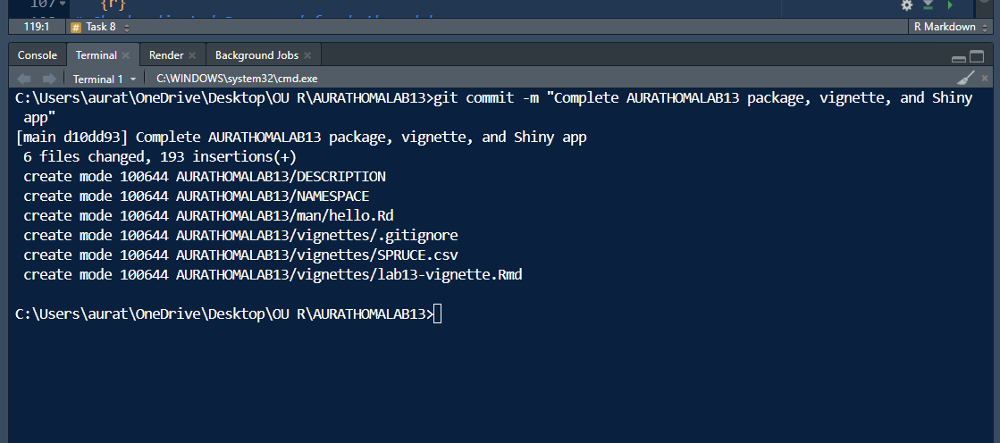

```{r, include = FALSE}
knitr::opts_chunk$set(
  collapse = TRUE,
  comment = "#>"
)
```

```{r setup}
library(AURATHOMALAB13)
```


# Task 2 {-}

```{r}
library(ggplot2)
spruce<-read.csv("SPRUCE.csv")
ggplot(spruce, aes(x=BHDiameter, y = Height))+
  geom_point(colour = "blue")+
  labs(title = "Aura Thoma's Plot")
```

# Task 3 {-}

```{r}
ggplot(spruce, aes(x=BHDiameter, y = Height))+
  geom_point(colour = "blue")+
  geom_smooth(method="loess", se = TRUE)+
  labs(title = "Aura Thoma's Plot")
```


# Task 4 {-}


```{r}
 lm(formula = Height ~ BHDiameter, data = spruce)

model <- lm(Height ~BHDiameter, data = spruce)

summary(model)
```


# Task 5 {-}

$$\begin{align}
\widehat{Height} &= \hat{\beta}_0 + \hat{\beta}_1 BHDiameter \\
\widehat{Height} &= 9.1468 + 0.4815 \times BHDiameter
\end{align}$$


```{r}
ggplot(spruce, aes(x = BHDiameter, y = Height)) +
  geom_point(color = "darkblue") +
  stat_smooth(method = "lm") +
  labs(title = "Aura Thoma's plot")
```


# Task 6 {-}

```{r}
library(dplyr)

# Wrangle the data using mutate to add residuals
spruce_mutated <- spruce %>%
  mutate(
    yhat = fitted(model),
    r_i = residuals(model)
  )

# Create the plot using ggplot and stat_smooth
ggplot(spruce_mutated, aes(x = yhat, y = r_i)) +
  geom_point(color = "darkblue") +
  stat_smooth(method = "loess") +
  labs(
    title = "Aura Thoma's plot",
    x = "yhat",
    y = "r_i"
  )
```

# Task 7 {-}


```{r}
# Fit the quadratic linear model using I()
model2 <- lm(Height ~ BHDiameter + I(BHDiameter^2), data = spruce)

# Display the summary output
summary(model2)
```

# Task 8 {-}


```{r}
# Check adjusted R-squared for both models
summary(model)$adj.r.squared
summary(model2)$adj.r.squared
```


Commit




Check
   ERROR: Unknown command "TMPDIR=C:/Users/aurat/AppData/Local/Temp/RtmpkTXOVb/file75c463862583". Did you mean command "update"?
   Warning message:
   In system2("quarto", "-V", stdout = TRUE, env = paste0("TMPDIR=",  :
     running command '"quarto" TMPDIR=C:/Users/aurat/AppData/Local/Temp/RtmpkTXOVb/file75c463862583 -V' had status 1
── R CMD check results ─────────────────────────────────────────────────────── AURATHOMALAB13 0.1.0 ────
Duration: 25.1s

0 errors ✔ | 0 warnings ✔ | 0 notes ✔


Shiny

 https://aura-overbooking.shinyapps.io/AURATHOMALAB13-spruce/
 
 

