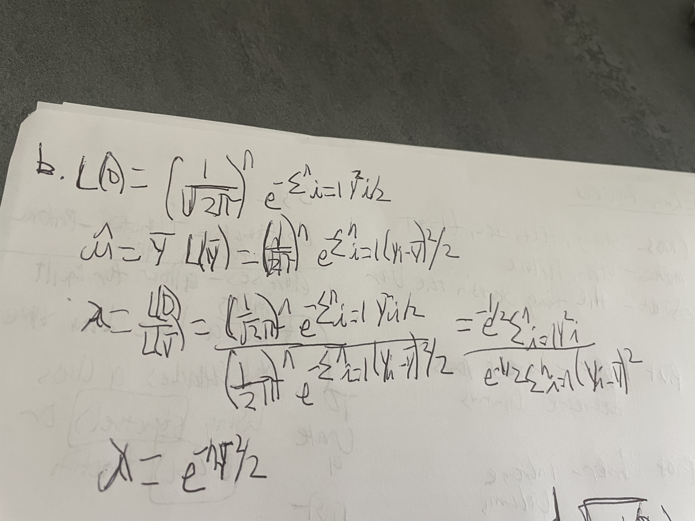
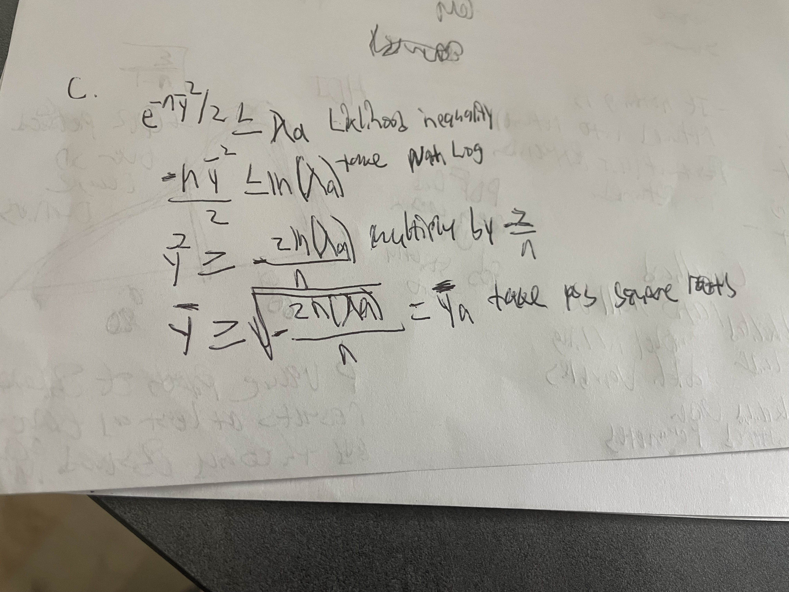
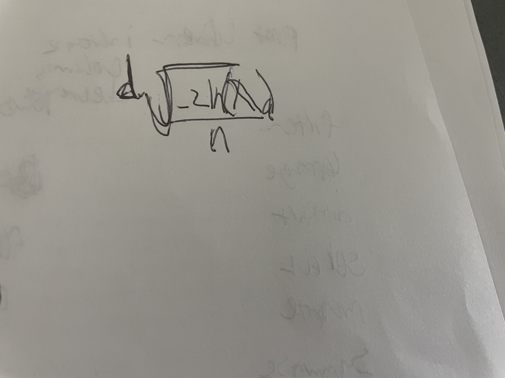

```{r setup, include=FALSE}
knitr::opts_chunk$set(echo = TRUE)
```

# Task 1 {-}

$$f(y) = \frac{1}{\sqrt{2\pi}} e^{-(y-\mu)^2/2}$$
$$L(\mu) = \prod_{i=1}^n f(y_i) = \prod_{i=1}^n \frac{1}{\sqrt{2\pi}} e^{-(y_i-\mu)^2/2}$$
$$L(\mu) = \left(\frac{1}{\sqrt{2\pi}}\right)^n e^{-\sum_{i=1}^n (y_i - \mu)^2 / 2}$$

```{r, echo=FALSE, out.width="100%"}

```
```{r}

```

```{r}

```

# Task 2 {-}

 Values to the left of the blue alpha = 0.05 critical cutoff log lambda alpha represent the rejection region for H0 in favor of H1, because smaller values of the likelihood ratio lambda indicate stronger evidence against the null hypothesis.Values to the right of the blue alpha = .05 critical cutoff y bar represent the rejection region for H1: mew >0, since larger sample means provide evidence supporting the alternative hypothesis.


```{r}
# Define the sample vector 
y <- c(4.4562, 5.4889, 4.4074, 5.0774, 4.9697, 4.6756, 4.8956, 5.9755, 4.6879, 5.1052)

# Call the package function 
l <- mylambda(iter = 10000, y = y, alpha = 0.05)

# Print names of list
names(l)

# Display specific cutoff values 
cat("loglamcut:\n")
print(l$loglamcut)

cat("\nybarcut:\n")
print(l$ybarcut)

cat("\nybarcutest:\n")
print(l$ybarcutest)
```

# Task 4 {-}

```{r}
# call mypower function 
mypower(n = 10, delta = 2, sigma = 2, alpha = 0.05)
```
```{r}
#install python
reticulate::py_install("scipy")

# Source python script
source_python("power_calc.py")

# Call the Python function directly 
result <- python_power_ttest(n = 26, delta = 1, sigma = 1.0, alpha = 0.05)

# Print result
print(result)
```

# Tasks 3 and 5 {-}


```{r, eval = FALSE}
# Launch the Task 3 app 
run_app3()

# Launch the Task 5 app 
run_app5()
```
